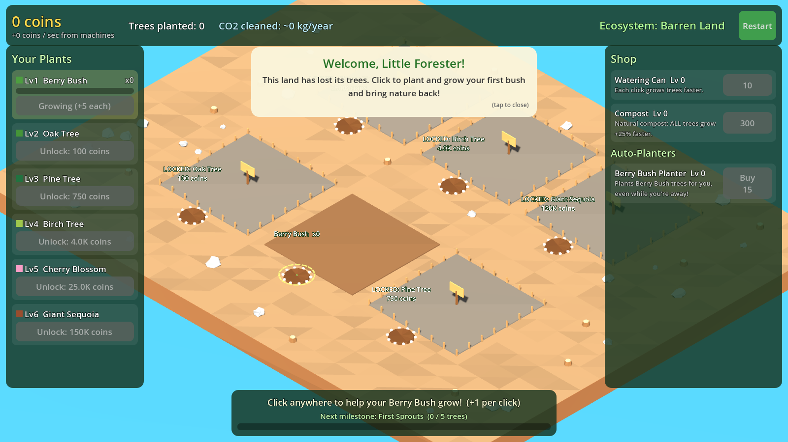
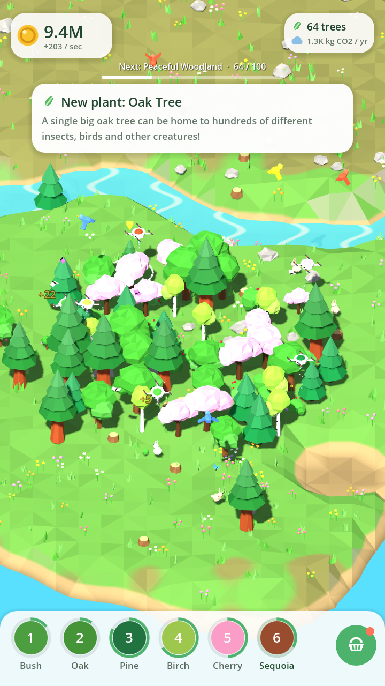
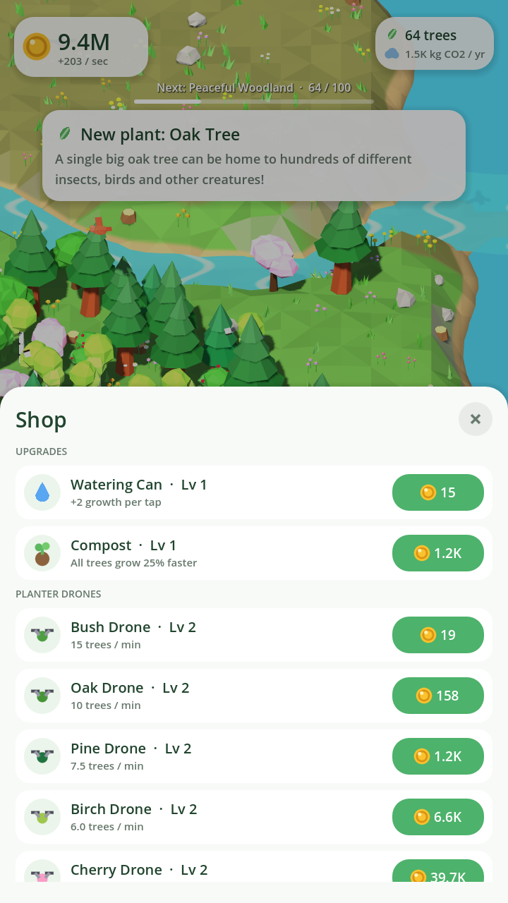
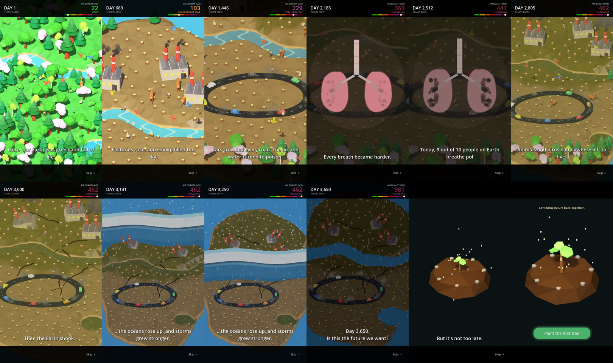

# Green Earth Tycoon 🌳

A low-poly, isometric **idle tree-planting tycoon** made in **Godot 4.3**, built to help children learn about
forests, ecosystems and sustainable development (UN SDG 13 *Climate Action* and SDG 15 *Life on Land*).

The game runs in **portrait mode** for phones and tablets. The player taps to grow trees on a barren island.
The trees spread out from one spot into a natural, mixed forest across open hills (there are no plots or
grids). Every grown tree earns coins. Coins buy upgrades and **Planter Drones** that keep planting for you.
As the forest grows, the ground turns green around it, the dried-up river and pond fill with water, flowers,
mountains, a jungle and a rainbow appear, and animals move in.

| Start: barren land | Forest spreading | Living Earth | Shop |
|---|---|---|---|
|  |  |  |  |

## Intro cinematic

On first launch, a ~75-second cinematic shows why the game exists. It plays on the same island the player
will later restore, while a **day counter** ticks up from Day 1 to Day 3,650 and an **AQI meter** climbs from
22 (Good) to 999+ (Hazardous):

1. A green island full of trees, deer, rabbits, birds and butterflies, with birdsong.
2. *"But every day, we took a little more."* The trees fall one by one, leaving stumps, and the land dries out.
3. Factories rise from the ground and smoke pours out of their chimneys. The sky turns grey.
4. A road appears with cars puffing exhaust. Poison spreads across the ground, and the river and pond turn murky.
5. Stylised lungs breathe, slowly turning grey and spotted. The breathing gets shallow, they cough, and a
   heartbeat speeds up. *"Today, 9 out of 10 people on Earth breathe polluted air."*
6. The animals and birds leave the island.
7. An earthquake: the screen shakes, cracks spread across the ground, and the factories collapse in dust.
8. The earthquake sets off a tsunami, a huge wave that rolls over the island, while lightning and rain
   hit and the sea rises and floods the low land.
9. Darkness. *"Day 3,650. Is this the future we want?"*
10. A single glowing sapling: *"But it's not too late. Every tree you plant helps heal our Earth."*
    Then the **Plant the first tree** button starts the game.

It is made for children, so it stays emotional without being graphic: the animals leave rather than die.
The soundtrack is **generated in code** (`intro_synth.gd`): a pad that slides from warm to dark, a factory
hum, wind, rain, thunder, an earthquake rumble, a heartbeat, birdsong and a hopeful chime.
Watch the full recording, with sound, in [`docs/intro_preview.mp4`](docs/intro_preview.mp4).



You can **Skip** it (or press Esc) at any time, and replay it from **Shop → Watch intro**.

## Running it

1. Install **Godot 4.3** or newer (the standard build; you don't need the .NET version).
2. In the Project Manager, choose **Import** and pick this folder's `project.godot`.
3. Press **F5**.

There are no art assets to download. Every model (trees, animals, machines, water, mountains) is built
in code from low-poly primitives, so the project runs straight after cloning.

### Controls
| Action | Touch | Desktop |
|---|---|---|
| Grow the selected plant | Tap anywhere | Click, or **Space** |
| Choose a plant / unlock one | Tap a round button in the bottom tray | Click |
| Pan | Drag | Drag, **WASD**, or the arrow keys |
| Zoom | Pinch | Mouse wheel, or **+ / -** |

On desktop the window opens at phone size (450×800). Change this under *Project Settings → Display → Window*.

## Game loop

1. **Tap**: each tap grows the sapling of the selected plant. It sits at the edge of the forest under a
   bouncing arrow, and the ring around its button in the tray shows how much it has grown.
2. **Tree grown**: you get coins, the tree stays where it grew, and a new sapling starts at a free spot
   nearby. This way the forest spreads outward like a real one, with all species mixed together.
3. **Spend coins** in the shop:
   - **Unlock plants** (levels 1–6): Berry Bush → Oak → Pine → Birch → Cherry Blossom → Giant Sequoia.
     Bigger trees take longer to grow but pay more.
   - **Planter Drone (one per plant level)**: a level-1 drone for level-1 plants, and so on. It flies over
     its plant's sapling and waters it. Upgrading it raises the planting speed, and the speed doubles every
     10 levels.
   - **Watering Can** gives more growth per click. **Compost** makes all trees grow 25% faster.
4. **Ecosystem milestones** (counted in total trees planted) change the world and bring new animals:

| Trees | Stage | World change | Animals |
|---|---|---|---|
| 0 | Barren Land | dry dirt, stumps, rocks, a dried-up riverbed | – |
| 5 | First Sprouts | grass | butterflies |
| 20 | Flowing River | the riverbed fills with water | birds |
| 50 | Blooming Meadow | wildflowers | rabbits |
| 100 | Peaceful Woodland | the dry hollow becomes a pond | deer |
| 200 | Wild Forest | mountains rise | wolves |
| 400 | Jungle Heart | ferns, bamboo, mushrooms | tigers |
| 800 | Living Earth | rainbow | elephants |

The ground turns green in a growing circle around the forest, and the whole island gets greener with each
milestone. Every milestone and every new plant shows a short, kid-friendly **eco fact** card. The top-right
card also shows roughly how much **CO2** the player's forest absorbs per year.

The game **autosaves** every 10 seconds and when you quit, including the exact spot of every tree.
**Offline progress** gives you what your drones grew while the game was closed (up to 8 hours).

## Project structure

```
project.godot                  Godot config (portrait 720x1280, GL Compatibility renderer for mobile/web)
scenes/main.tscn               Single scene; everything else is built in code
scripts/
  main.gd                      Lighting/sky, camera, HUD, tap handling, dev autotest
  autoload/game_state.gd       Economy: coins, growth, drones, upgrades, milestones, save/load, offline
  data/game_data.gd            ALL balancing + content: plants, costs, stages, facts  <- tweak here
  util/low_poly.gd             Turns primitives into faceted, vertex-coloured low-poly meshes
  world/terrain.gd             Island heightmap (hills, dry riverbed, pond hollow) + ground shader
  world/forest.gd              Natural forest growth: spot finding, saplings, drones, MultiMesh trees
  world/world.gd               Ocean, decorations, milestone features (river, pond, mountains...), animals
  world/tree_factory.gd        Tree + Planter Drone models
  world/animal.gd              Animal behaviour (fly / walk / hop over the hills)
  world/animal_factory.gd      Animal models (butterfly, bird, rabbit, deer, wolf, tiger, elephant)
  world/iso_camera.gd          Orthographic isometric camera: tap, drag-pan, pinch-zoom
  ui/hud.gd                    Minimal UI: coin and stat cards, milestone bar, plant tray, shop sheet, fact cards
  ui/plant_chip.gd             Round plant button with a growth ring
  ui/ui_icon.gd                Small vector icons drawn in code
scenes/intro.tscn              Intro cinematic
scripts/intro/
  intro.gd                     Timeline / director: camera shots, captions, day counter, AQI, sky, sound
  intro_world.gd               The 3D set: forest, factories + smoke, road + cars, poison, cracks, tsunami, rain, lightning
  lungs_view.gd                Breathing lungs drawn in 2D
  aqi_meter.gd                 Air Quality Index meter (US EPA colour bands)
  intro_synth.gd               Procedural soundtrack (no audio files)
```

The economy (`GameState`) only sends signals. The 3D world and the HUD listen to them, so you can rebalance
or replace visuals without touching the economy code.

## Extending

- **Add a plant**: add an entry to `GameData.PLANTS` (set `radius` to the room the tree needs) and a model
  function in `TreeFactory`.
- **Change the island**: edit `Terrain._height_fn` (hills, coastline, riverbed, pond).
- **Add a milestone**: add an entry to `GameData.STAGES`. Give it a `feature` (a builder in `World._unlock_stage_content`)
  and/or an `animal` (a model in `AnimalFactory`).
- **Use Blender models**: replace `TreeFactory.tree_mesh()` or `AnimalFactory.create()` so they return
  meshes or scenes from imported `.glb` files. The rest of the game doesn't need to change.

### Dev flags
Pass these after `--` on the command line, or under *Project Settings → Run → Main Run Args*:
- `--fresh`: ignore the save file (this also replays the intro).
- `--no-intro`: skip the intro cinematic.
- `--autotest`: fast-forward through every milestone to preview all visuals.
- `--until=N`: stop the autotest at N trees.
- `--shop`: open the shop before taking the screenshot.
- `--zoom=N`: start zoomed out to camera size N.
- `--shot=out.png`: save a screenshot and quit.

Intro scene (`godot --path . res://scenes/intro.tscn -- ...`): `--shots=DIR` saves screenshots of 11 key
moments, and `--finish-at=T` presses Skip after T seconds. To record the intro as a video, use Godot's
Movie Maker: `--write-movie intro.avi --fixed-fps 30`.

## Ideas for next steps
- Sound: click "pop", coin chime, birdsong and river ambience that grow with each stage.
- A short quiz after each milestone, with a coin bonus for right answers.
- Seasons, day/night, and threats (wildfire, litter, drought) that kids learn to prevent.
- An HTML5 export for classrooms, and Android/iOS builds.
- Bigger trees slowly taking over from bushes as the forest matures.
- Imported hand-made low-poly models and animations.
