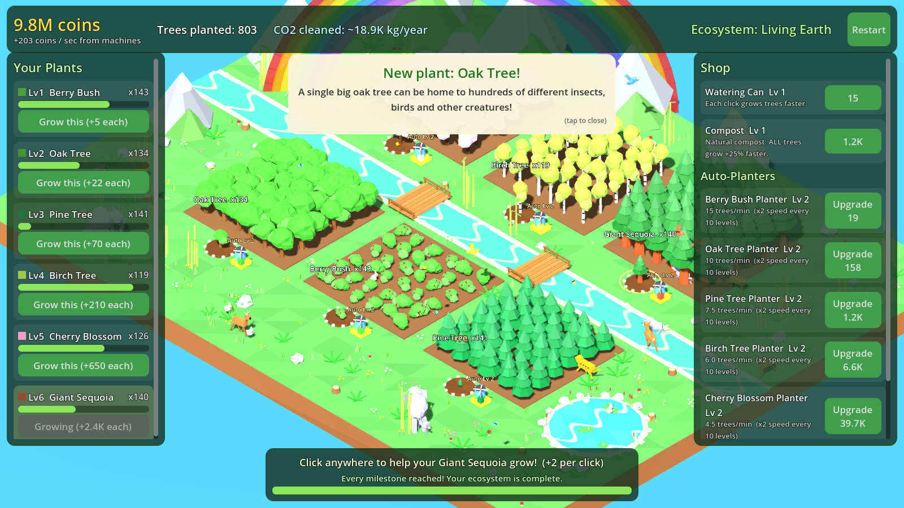

# Green Earth Tycoon 🌳

A low-poly, isometric **idle tree-planting tycoon** made in **Godot 4.3**, built to help children learn about
forests, ecosystems and sustainable development (UN SDG 13 *Climate Action* and SDG 15 *Life on Land*).

The player clicks to grow trees on barren land. Every grown tree earns coins. Coins buy upgrades and
**Auto-Planter machines** that keep planting for you. As the forest grows, the land comes back to life:
grass, a river, flowers, a pond, mountains, a jungle and a rainbow appear, and animals move in.

| Start: barren land | Later: a living ecosystem |
|---|---|
|  |  |

## Running it

1. Install **Godot 4.3** or newer (the standard build; you don't need the .NET version).
2. In the Project Manager, choose **Import** and pick this folder's `project.godot`.
3. Press **F5**.

There are no art assets to download. Every model (trees, animals, machines, water, mountains) is built
in code from low-poly primitives, so the project runs straight after cloning.

### Controls
| Action | Input |
|---|---|
| Grow the selected tree | Left-click / tap anywhere, or **Space** |
| Switch to another plant | Click its plot, or **Grow this** in the left panel |
| Pan | Right/middle-drag, **WASD**, or the arrow keys |
| Zoom | Mouse wheel, or **+ / -** |

## Game loop

1. **Click**: each click adds growth to the tree in the selected plot's round *nursery bed*.
2. **Tree grown**: you get coins, the tree hops into the plot's forest grid, and a new sapling starts.
3. **Spend coins** in the shop:
   - **Unlock plants** (levels 1–6): Berry Bush → Oak → Pine → Birch → Cherry Blossom → Giant Sequoia.
     Bigger trees take longer to grow but pay more.
   - **Auto-Planter (per plant level)**: a level-1 machine for level-1 plants, and so on. Upgrading
     it raises the planting speed, and the speed doubles every 10 levels.
   - **Watering Can** gives more growth per click. **Compost** makes all trees grow 25% faster.
4. **Ecosystem milestones** (counted in total trees planted) change the world and bring new animals:

| Trees | Stage | World change | Animals |
|---|---|---|---|
| 0 | Barren Land | stumps & rocks | – |
| 5 | First Sprouts | grass | butterflies |
| 20 | Flowing River | river + bridges | birds |
| 50 | Blooming Meadow | wildflowers | rabbits |
| 100 | Peaceful Woodland | pond with lily pads | deer |
| 200 | Wild Forest | mountains rise | wolves |
| 400 | Jungle Heart | ferns, bamboo, mushrooms | tigers |
| 800 | Living Earth | rainbow | elephants |

Every milestone and every new plant shows a short, kid-friendly **eco fact** popup. The top bar also shows
roughly how much **CO2** the player's forest absorbs per year.

The game **autosaves** every 10 seconds and when you quit. **Offline progress** gives you what your machines
earned while the game was closed (up to 8 hours).

## Project structure

```
project.godot                  Godot config (GL Compatibility renderer, so it also works on web/mobile)
scenes/main.tscn               Single scene; everything else is built in code
scripts/
  main.gd                      Lighting/sky, camera, HUD, click handling, dev autotest
  autoload/game_state.gd       Economy: coins, growth, machines, upgrades, milestones, save/load, offline
  data/game_data.gd            ALL balancing + content: plants, costs, stages, facts  <- tweak here
  util/low_poly.gd             Turns primitives into faceted, vertex-coloured low-poly meshes
  world/world.gd               Island, plots, river/pond/mountains/etc., animal spawning
  world/zone.gd                One plant plot: nursery tree, forest grid, machine, lock sign
  world/tree_factory.gd        Tree + Auto-Planter models
  world/animal.gd              Animal behaviour (fly / walk / hop, wings & legs animation)
  world/animal_factory.gd      Animal models (butterfly, bird, rabbit, deer, wolf, tiger, elephant)
  world/iso_camera.gd          Orthographic isometric camera with pan/zoom
  ui/hud.gd                    Stats bar, plants panel, shop, milestone bar, eco-fact popups
```

The economy (`GameState`) only sends signals. The 3D world and the HUD listen to them, so you can rebalance
or replace visuals without touching the economy code.

## Extending

- **Add a plant**: add an entry to `GameData.PLANTS`, a model function in `TreeFactory`, and a position
  in `World.ZONE_POSITIONS`.
- **Add a milestone**: add an entry to `GameData.STAGES`. Give it a `feature` (a builder in `World._unlock_stage_content`)
  and/or an `animal` (a model in `AnimalFactory`).
- **Use Blender models**: replace `TreeFactory.tree_mesh()` or `AnimalFactory.create()` so they return
  meshes or scenes from imported `.glb` files. The rest of the game doesn't need to change.

### Dev flags
Pass these after `--` on the command line, or under *Project Settings → Run → Main Run Args*:
- `--fresh`: ignore the save file.
- `--autotest`: fast-forward through every milestone to preview all visuals.
- `--shot=out.png`: save a screenshot and quit.

## Ideas for next steps
- Sound: click "pop", coin chime, birdsong and river ambience that grow with each stage.
- A short quiz after each milestone, with a coin bonus for right answers.
- Seasons, day/night, and threats (wildfire, litter, drought) that kids learn to prevent.
- Touch-first UI layout for tablets, and an HTML5 export for classrooms.
- Imported hand-made low-poly models and animations.
